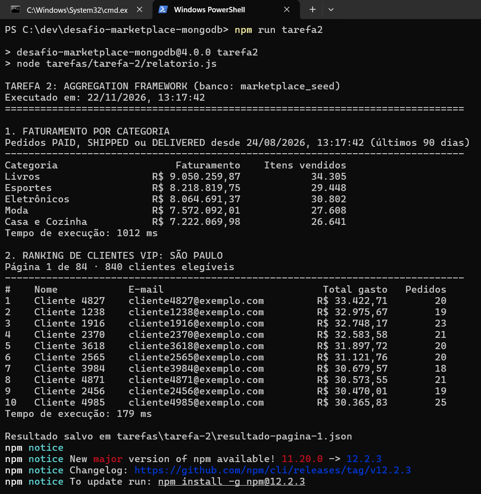
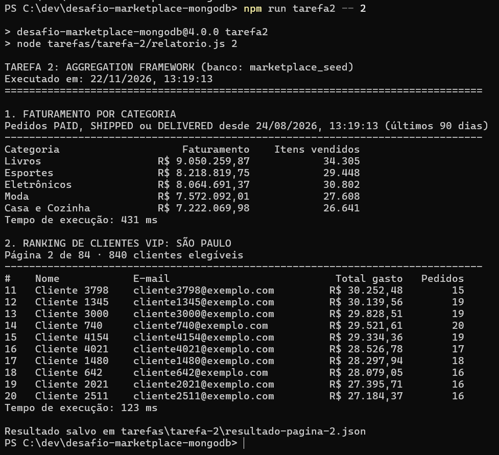

# Tarefa 2: Aggregation Framework

**Desafio Técnico Back-End: Engenharia de Dados com MongoDB**
Luka Gomes · Desenvolvimento de Software Multiplataforma · FATEC Jacareí · 22/11/2026

---

## 1. Objetivo e execução

Criar dois pipelines de agregação **executados diretamente no banco**, sem processar arrays na memória da aplicação:

1. **Relatório de faturamento por categoria**: faturamento total e quantidade de itens vendidos por categoria, considerando apenas pedidos `PAID`, `SHIPPED` ou `DELIVERED` dos **últimos 90 dias**, do maior faturamento para o menor.
2. **Ranking de clientes VIP (paginado)**: os 10 clientes de **São Paulo** que mais gastaram, com nome e e-mail (buscados em `users`), total gasto e quantidade de pedidos. O `$facet` retorna na mesma consulta os dados da página e a contagem total de clientes elegíveis.

| Item | Valor |
|---|---|
| Banco | `marketplace_seed` (gerado na Parte 4: 100.000 pedidos, 5.000 usuários) |
| Script | `tarefas/tarefa-2/relatorio.js` |
| Execução | `npm run tarefa2` (página 1) e `npm run tarefa2 -- 2` (página 2) |
| Data da execução | **22/11/2026, 13:17** (janela de 90 dias: a partir de **24/08/2026, 13:17**) |
| Resultados brutos | `tarefas/tarefa-2/resultado-pagina-1.json` e `resultado-pagina-2.json` |

O papel do Node.js é só **enviar o pipeline** com `collection.aggregate([...])` e **exibir** o resultado final, que já chega pronto do banco: 5 linhas no relatório 1 e 1 documento com 10 clientes no relatório 2.

> **Observação:** "últimos 90 dias" é uma janela relativa à data de execução. Como os pedidos do seed foram gerados com datas aleatórias nos últimos 180 dias, rodar o script em outro dia muda os números. Os valores deste relatório correspondem à execução registrada acima.

---

## 2. Relatório 1: faturamento por categoria

### 2.1 Pipeline

```js
const dataInicial = new Date(Date.now() - 90 * 24 * 60 * 60 * 1000);

db.orders.aggregate([
  // 1) Filtra cedo: só pedidos pagos/enviados/entregues dos últimos 90 dias
  { $match: {
      status: { $in: ["PAID", "SHIPPED", "DELIVERED"] },
      createdAt: { $gte: dataInicial }
  } },

  // 2) Cada item do pedido vira um documento (um pedido pode ter várias categorias)
  { $unwind: "$items" },

  // 3) Agrupa por categoria: faturamento = soma de preço unitário x quantidade
  { $group: {
      _id: "$items.category",
      faturamentoTotal: { $sum: { $multiply: ["$items.unitPrice", "$items.quantity"] } },
      itensVendidos:    { $sum: "$items.quantity" },
      pedidos:          { $sum: 1 }
  } },

  // 4) Do maior faturamento para o menor
  { $sort: { faturamentoTotal: -1 } },

  // 5) Formata a saída
  { $project: {
      _id: 0,
      categoria: "$_id",
      faturamentoTotal: { $round: ["$faturamentoTotal", 2] },
      itensVendidos: 1,
      linhasDePedido: "$pedidos",
      ticketMedioPorItem: { $round: [{ $divide: ["$faturamentoTotal", "$itensVendidos"] }, 2] }
  } }
])
```

### 2.2 Explicação das etapas

| Etapa | O que faz | Por quê |
|---|---|---|
| `$match` | Mantém só os pedidos com status válido e data dentro da janela | É a **primeira** etapa para reduzir o volume o quanto antes: as etapas seguintes processam só os pedidos relevantes, e não os 100.000 |
| `$unwind` | Transforma cada item do array `items` num documento separado | Um pedido pode ter itens de **categorias diferentes**. Agrupar o pedido inteiro atribuiria o valor todo a uma categoria só |
| `$group` | Soma `unitPrice × quantity` (faturamento) e `quantity` (itens) por categoria | Usa o **preço do momento da compra**, guardado no item, e não o preço atual do produto |
| `$sort` | Ordena por faturamento decrescente | Exigência do enunciado |
| `$project` | Renomeia campos, arredonda valores e calcula o ticket médio | Saída pronta para exibição, sem tratamento na aplicação |

**Por que não há `$lookup` em `products`:** o seed já **copia a categoria e o preço unitário para dentro de cada item do pedido** (desnormalização). Por isso o relatório sai inteiro da coleção `orders`, sem juntar coleções, o que é bem mais barato. É o tipo de decisão de modelagem discutida na Tarefa 1: o dado é duplicado de propósito porque o padrão de acesso (relatórios de vendas) pede isso.

### 2.3 Resultado

Pedidos `PAID`, `SHIPPED` ou `DELIVERED` de **24/08/2026 a 22/11/2026**:

| # | Categoria | Faturamento total | Itens vendidos | Participação | Ticket médio por item |
|---|---|---:|---:|---:|---:|
| 1 | Livros | **R$ 9.050.259,87** | 34.305 | 22,6% | R$ 263,82 |
| 2 | Esportes | R$ 8.218.819,75 | 29.448 | 20,5% | R$ 279,10 |
| 3 | Eletrônicos | R$ 8.064.691,37 | 30.802 | 20,1% | R$ 261,82 |
| 4 | Moda | R$ 7.572.092,01 | 27.608 | 18,9% | R$ 274,27 |
| 5 | Casa e Cozinha | R$ 7.222.069,98 | 26.641 | 18,0% | R$ 271,09 |
| | **Total** | **R$ 40.127.932,98** | **148.804** | 100% | |

**Leitura dos resultados:**

- **Livros** lidera em faturamento e em volume (34.305 itens), mas não tem o maior ticket médio por item.
- **Esportes** fatura mais que **Eletrônicos** mesmo vendendo menos itens (29.448 contra 30.802), porque o ticket médio é maior (R$ 279,10 contra R$ 261,82).
- A distribuição é relativamente equilibrada (de 18% a 22,6%), o que é esperado: o seed sorteia categorias e preços de forma uniforme.

---

## 3. Relatório 2: ranking de clientes VIP (paginado)

### 3.1 Pipeline

```js
const pagina = 1, tamanhoPagina = 10;

db.orders.aggregate([
  // 1) Pedidos de São Paulo que representam gasto efetivo
  { $match: {
      shippingCity: "São Paulo",
      status: { $in: ["PAID", "SHIPPED", "DELIVERED"] }
  } },

  // 2) Total gasto e quantidade de pedidos por cliente
  { $group: {
      _id: "$userId",
      totalGasto:        { $sum: "$totalAmount" },
      quantidadePedidos: { $sum: 1 }
  } },

  // 3) Do maior gasto para o menor (_id desempata e deixa a paginação estável)
  { $sort: { totalGasto: -1, _id: 1 } },

  // 4) Duas sub-pipelines sobre o mesmo resultado, numa única consulta
  { $facet: {
      metadados: [ { $count: "totalClientes" } ],
      dados: [
        { $skip: (pagina - 1) * tamanhoPagina },
        { $limit: tamanhoPagina },
        { $lookup: { from: "users", localField: "_id", foreignField: "_id", as: "usuario" } },
        { $unwind: "$usuario" },
        { $project: {
            _id: 0, userId: "$_id",
            nome: "$usuario.name", email: "$usuario.email",
            totalGasto: { $round: ["$totalGasto", 2] },
            quantidadePedidos: 1
        } }
      ]
  } },

  // 5) Resposta final com os dados de paginação
  { $project: {
      totalClientes: { $ifNull: [{ $arrayElemAt: ["$metadados.totalClientes", 0] }, 0] },
      pagina: { $literal: pagina },
      tamanhoPagina: { $literal: tamanhoPagina },
      dados: 1
  } },
  { $set: { totalPaginas: { $ceil: { $divide: ["$totalClientes", tamanhoPagina] } } } }
])
```

### 3.2 Explicação das etapas

| Etapa | O que faz | Por quê |
|---|---|---|
| `$match` | Filtra pedidos de São Paulo com status válido | Reduz o volume antes do agrupamento |
| `$group` | Soma `totalAmount` e conta os pedidos de cada `userId` | Um documento por cliente elegível |
| `$sort` | Ordena por total gasto (desc.) e `_id` (desempate) | Sem desempate, clientes com o mesmo total poderiam trocar de página entre consultas |
| `$facet` | Executa **duas sub-pipelines** sobre o mesmo resultado | `metadados` conta todos os clientes elegíveis; `dados` devolve só a página pedida. **Uma única ida ao banco** traz as duas informações |
| `$lookup` (dentro de `dados`) | Busca nome e e-mail em `users` | Fica **depois** do `$skip`/`$limit`: a junção é feita só para os **10 clientes da página**, e não para os 840 elegíveis |
| `$project` / `$set` | Monta a resposta com `totalClientes`, `pagina` e `totalPaginas` | O front-end recebe tudo pronto para montar a paginação |

### 3.3 Decisões de interpretação

O enunciado deixa dois pontos em aberto. As decisões abaixo foram tomadas e aplicadas no pipeline:

1. **"Clientes de São Paulo" = pedidos com `shippingCity: "São Paulo"`.** No seed, a cidade de entrega é sempre igual à cidade do cadastro (`shippingCity: user.city`), então o resultado seria o mesmo filtrando por `users.city`. Filtrar por `shippingCity` permite que o `$match` seja a **primeira etapa**, direto na coleção `orders`. A alternativa exigiria um `$lookup` dos 100.000 pedidos em `users` antes de filtrar.
2. **"Mais gastaram" considera apenas `PAID`, `SHIPPED` e `DELIVERED`.** Pedidos `CANCELED` não geraram gasto, e pedidos `PENDING` ainda não foram pagos. Foram usados os mesmos status do relatório 1, para manter os dois relatórios coerentes. Sem limite de período, porque o enunciado não pede.

### 3.4 Resultado

**840 clientes elegíveis → 84 páginas de 10 clientes.**

**Página 1 (Top 10):**

| # | Nome | E-mail | Total gasto | Pedidos |
|---:|---|---|---:|---:|
| 1 | Cliente 4827 | cliente4827@exemplo.com | **R$ 33.422,71** | 20 |
| 2 | Cliente 1238 | cliente1238@exemplo.com | R$ 32.975,67 | 19 |
| 3 | Cliente 1916 | cliente1916@exemplo.com | R$ 32.748,17 | 23 |
| 4 | Cliente 2370 | cliente2370@exemplo.com | R$ 32.583,58 | 21 |
| 5 | Cliente 3618 | cliente3618@exemplo.com | R$ 31.897,72 | 20 |
| 6 | Cliente 2565 | cliente2565@exemplo.com | R$ 31.121,76 | 20 |
| 7 | Cliente 3984 | cliente3984@exemplo.com | R$ 30.679,57 | 18 |
| 8 | Cliente 4871 | cliente4871@exemplo.com | R$ 30.573,55 | 21 |
| 9 | Cliente 2456 | cliente2456@exemplo.com | R$ 30.470,01 | 19 |
| 10 | Cliente 4985 | cliente4985@exemplo.com | R$ 30.365,83 | 25 |

**Página 2 (comprovação da paginação):**

| # | Nome | E-mail | Total gasto | Pedidos |
|---:|---|---|---:|---:|
| 11 | Cliente 3798 | cliente3798@exemplo.com | R$ 30.252,48 | 15 |
| 12 | Cliente 1345 | cliente1345@exemplo.com | R$ 30.139,56 | 19 |
| 13 | Cliente 3000 | cliente3000@exemplo.com | R$ 29.828,51 | 19 |
| 14 | Cliente 740 | cliente740@exemplo.com | R$ 29.521,61 | 20 |
| 15 | Cliente 4154 | cliente4154@exemplo.com | R$ 29.334,36 | 19 |
| 16 | Cliente 4021 | cliente4021@exemplo.com | R$ 28.526,78 | 17 |
| 17 | Cliente 1480 | cliente1480@exemplo.com | R$ 28.297,94 | 18 |
| 18 | Cliente 642 | cliente642@exemplo.com | R$ 28.079,05 | 16 |
| 19 | Cliente 2021 | cliente2021@exemplo.com | R$ 27.395,71 | 16 |
| 20 | Cliente 2511 | cliente2511@exemplo.com | R$ 27.184,37 | 16 |

**Leitura dos resultados:**

- A página 2 começa exatamente onde a página 1 termina (R$ 30.365,83 → R$ 30.252,48), sem repetições nem saltos, e as duas informam o mesmo total de **840 clientes**. Isso confirma que a paginação com `$facet` está correta.
- O ranking é definido pelo **valor gasto**, não pelo número de pedidos: o 10º colocado (Cliente 4985) tem a maior quantidade de pedidos do Top 10 (25), mas ticket médio menor.
- Os 840 clientes elegíveis são praticamente todos os usuários de São Paulo (cerca de 1/6 dos 5.000 cadastrados), já que cada usuário tem em média 20 pedidos no seed (100.000 ÷ 5.000), dos quais cerca de 60% têm status válido.

---

## 4. Desempenho e próximos passos

| Relatório | 1ª execução (página 1) | 2ª execução (página 2) |
|---|---:|---:|
| 1. Faturamento por categoria | 1.012 ms | 431 ms |
| 2. Clientes VIP (página) | 179 ms | 123 ms |

- A primeira execução é mais lenta porque os dados ainda não estavam no cache do MongoDB (*cache frio*).
- Como a coleção `orders` **não tem índices secundários** (Parte 4), os dois `$match` precisam ler os 100.000 pedidos (`COLLSCAN`) para encontrar os que atendem ao filtro.
- Índices que acelerariam esses relatórios, seguindo a regra **ESR** (*Equality, Sort, Range*):
  - Relatório 1: `{ status: 1, createdAt: 1 }`: igualdade em `status` e intervalo em `createdAt`.
  - Relatório 2: `{ shippingCity: 1, status: 1 }`: as duas igualdades do `$match`.

O diagnóstico com `explain("executionStats")` e a comprovação do ganho com índices são feitos na **Tarefa 3**.

---

## 5. Conclusão

Os dois relatórios foram resolvidos inteiramente pelo **Aggregation Framework**: filtragem, desmembramento dos itens, agrupamento, ordenação, junção com `users` e paginação acontecem no banco, e a aplicação recebe o resultado final pronto. As principais boas práticas aplicadas foram:

- **`$match` como primeira etapa**, para reduzir o volume o quanto antes;
- **aproveitamento da desnormalização** (`category` e `unitPrice` dentro do item), que dispensa `$lookup` no relatório 1;
- **`$lookup` depois de `$skip`/`$limit`**, para juntar só os 10 clientes exibidos;
- **`$facet`** para obter os dados da página e a contagem total numa única consulta;
- **ordenação com desempate por `_id`**, para uma paginação estável.

<div style="page-break-before: always"></div>

## 6. Evidências

**Execução: página 1** (`npm run tarefa2`)



**Execução: página 2** (`npm run tarefa2 -- 2`)


