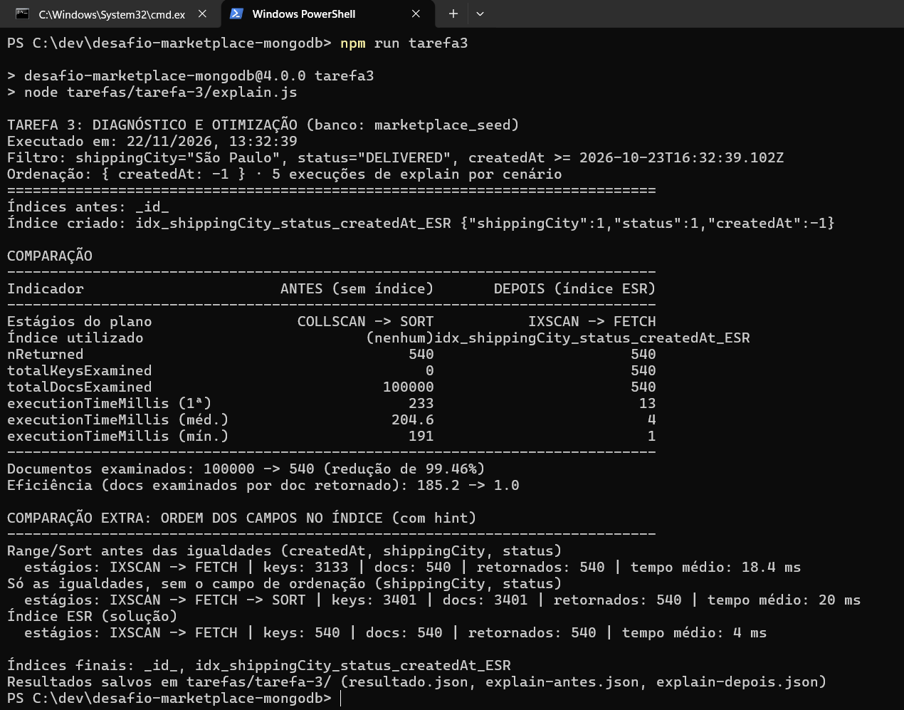
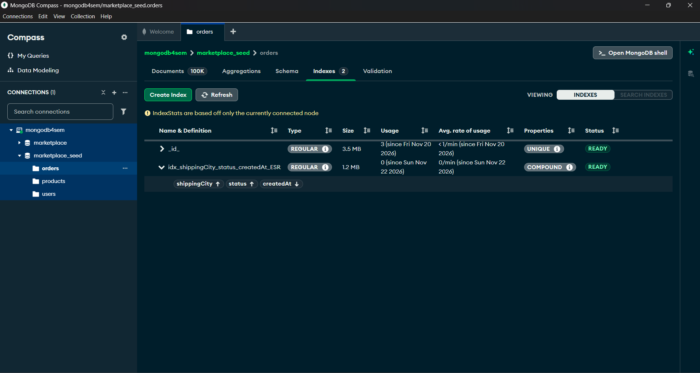
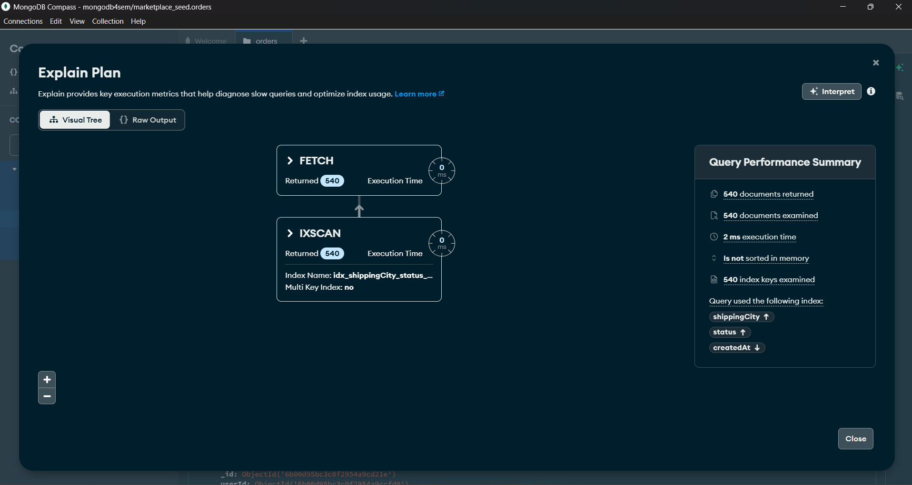

# Tarefa 3: Diagnóstico e Otimização de Performance

**Desafio Técnico Back-End: Engenharia de Dados com MongoDB**
Luka Gomes · Desenvolvimento de Software Multiplataforma · FATEC Jacareí · 22/11/2026

---

## 1. O problema

O time de operações reportou lentidão extrema na busca de pedidos por **status** e **cidade**, ordenada por **data de criação**:

```js
db.orders.find({
  shippingCity: "São Paulo",
  status: "DELIVERED",
  createdAt: { $gte: new Date(Date.now() - 30 * 86400000) }
}).sort({ createdAt: -1 })
```

| Item | Valor |
|---|---|
| Banco / coleção | `marketplace_seed.orders`, **100.000 documentos**, gerados na Parte 4 |
| Índices existentes no início | apenas `_id_` (o seed não cria índices secundários) |
| Servidor | MongoDB 9.0.4 (replica set `rs0`, local) |
| Script | `tarefas/tarefa-3/explain.js`, executado com `npm run tarefa3` |
| Execução | **22/11/2026, 13:32**: janela de 30 dias a partir de **23/10/2026, 13:32** |
| Evidências brutas | `resultado.json`, `explain-antes.json` e `explain-depois.json` (mesma pasta) |

**Como a medição foi feita:** o script usa a **mesma janela de datas** antes e depois do índice e executa cada `explain("executionStats")` **5 vezes**, registrando a primeira execução, a média e o mínimo. A primeira execução de cada cenário costuma ser mais lenta porque os dados ainda não estão no cache do MongoDB (*cache frio*). Antes de medir, o script também remove o índice da solução caso ele já exista, garantindo que o "antes" seja realmente sem índice.

---

## 2. Passo 1: diagnóstico da consulta original

### 2.1 Resultado do `explain("executionStats")`

| Indicador | Valor |
|---|---|
| **Estágio utilizado** | **`COLLSCAN`** (varredura completa da coleção), seguido de **`SORT`** em memória |
| **`executionTimeMillis`** | **233 ms** na 1ª execução · **204,6 ms** de média · 191 ms no melhor caso |
| **`totalDocsExamined`** | **100.000** (todos os documentos da coleção) |
| `totalKeysExamined` | 0 (nenhum índice foi usado) |
| `nReturned` | 540 |

Trecho do `explain` original (`explain-antes.json`):

```json
"executionStats": {
  "nReturned": 540,
  "executionTimeMillis": 200,
  "totalKeysExamined": 0,
  "totalDocsExamined": 100000,
  "executionStages": {
    "stage": "SORT",
    "sortPattern": { "createdAt": -1 },
    "totalDataSizeSorted": 240798,
    "usedDisk": false,
    "inputStage": {
      "stage": "COLLSCAN",
      "filter": { "$and": [
        { "shippingCity": { "$eq": "São Paulo" } },
        { "status": { "$eq": "DELIVERED" } },
        { "createdAt": { "$gte": "2026-10-23T16:32:39.102Z" } }
      ] },
      "docsExamined": 100000
    }
  }
}
```

### 2.2 Interpretação

- **`COLLSCAN`:** sem um índice que atenda ao filtro, o MongoDB precisa **ler os 100.000 pedidos**, um por um, e testar as três condições em cada um.
- **Desperdício:** foram examinados **100.000 documentos para devolver 540**. São **185 documentos lidos para cada documento útil**, e 99,46% do trabalho é descartado.
- **`SORT` em memória:** depois de filtrar, o banco ainda precisa **ordenar** os 540 resultados por `createdAt` em memória (~240 KB). Com mais dados, essa etapa pode estourar o limite de memória do sort (100 MB, campo `memLimit`) e passar a usar disco.
- **Por que piora com o tempo:** o custo do `COLLSCAN` cresce **linearmente com o tamanho da coleção**. Com 1 milhão de pedidos, a mesma consulta leria 1 milhão de documentos para devolver praticamente os mesmos ~540 resultados. É exatamente o cenário de "lentidão extrema" relatado.

---

## 3. Passo 2: criação do índice composto pela regra ESR

### 3.1 A regra ESR

Para índices compostos, a ordem recomendada dos campos é:

1. **E (Equality):** campos comparados por **igualdade exata**. Vêm primeiro porque restringem o índice a um "bloco" contínuo de entradas.
2. **S (Sort):** campos usados na **ordenação**. Dentro do bloco das igualdades, as entradas já ficam na ordem certa, o que elimina o `SORT` em memória.
3. **R (Range):** campos com **intervalos** (`$gte`, `$lt`, `$in` com muitos valores…). Vêm por último para não "quebrar" a ordenação nem espalhar a busca.

### 3.2 Aplicando à consulta

| Campo | Uso na consulta | Classificação ESR |
|---|---|---|
| `shippingCity` | `= "São Paulo"` | **E**quality |
| `status` | `= "DELIVERED"` | **E**quality |
| `createdAt` | `sort({ createdAt: -1 })` **e** `$gte` | **S**ort (e também o **R**ange) |

O campo `createdAt` é ao mesmo tempo o campo de ordenação e o do intervalo. Por isso ele aparece **uma única vez**, depois das igualdades, e atende às duas funções: o banco percorre o índice a partir da data mais recente e **para** quando chega ao limite de 30 dias.

O sentido `-1` acompanha a ordenação pedida (`createdAt: -1`). Em índices de um único campo de ordenação o MongoDB também consegue percorrer o índice ao contrário, mas declarar o mesmo sentido deixa a intenção explícita.

### 3.3 Comando

```js
db.orders.createIndex(
  { shippingCity: 1, status: 1, createdAt: -1 },
  { name: "idx_shippingCity_status_createdAt_ESR" }
)
```

O índice ocupa **1,2 MB** (contra 3,5 MB do índice `_id`), um custo baixo de armazenamento e de escrita para o ganho obtido.

---

## 4. Passo 3: nova medição e comprovação da melhoria

### 4.1 Comparação

| Indicador | **Antes** (sem índice) | **Depois** (índice ESR) | Melhoria |
|---|---|---|---|
| Estágios do plano | `COLLSCAN` → `SORT` | **`IXSCAN` → `FETCH`** | sem varredura total e sem sort em memória |
| Índice utilizado | nenhum | `idx_shippingCity_status_createdAt_ESR` | |
| `nReturned` | 540 | 540 | mesmo resultado |
| `totalKeysExamined` | 0 | 540 | |
| **`totalDocsExamined`** | **100.000** | **540** | **−99,46%** (185× menos) |
| Docs examinados por doc retornado | 185,2 | **1,0** | eficiência máxima |
| **`executionTimeMillis`** (1ª execução) | **233 ms** | **13 ms** | ~18× mais rápido |
| `executionTimeMillis` (média de 5) | 204,6 ms | **4 ms** | **~51× mais rápido** |
| `executionTimeMillis` (mínimo) | 191 ms | 1 ms | |

Trecho do `explain` com o índice (`explain-depois.json`):

```json
"executionStats": {
  "nReturned": 540,
  "executionTimeMillis": 1,
  "totalKeysExamined": 540,
  "totalDocsExamined": 540,
  "executionStages": {
    "stage": "FETCH",
    "docsExamined": 540,
    "inputStage": {
      "stage": "IXSCAN",
      "indexName": "idx_shippingCity_status_createdAt_ESR",
      "keyPattern": { "shippingCity": 1, "status": 1, "createdAt": -1 },
      "indexBounds": {
        "shippingCity": ["[\"São Paulo\", \"São Paulo\"]"],
        "status":       ["[\"DELIVERED\", \"DELIVERED\"]"],
        "createdAt":    ["[new Date(9223372036854775807), new Date(1792773159102)]"]
      },
      "keysExamined": 540,
      "seeks": 1
    }
  }
}
```

### 4.2 Interpretação

- **`IXSCAN` em vez de `COLLSCAN`:** o banco vai direto ao trecho do índice onde estão os pedidos de São Paulo com status DELIVERED (`indexBounds`) e lê só as entradas dos últimos 30 dias, com **um único `seek`**.
- **`totalKeysExamined = totalDocsExamined = nReturned = 540`:** é o cenário ideal. Cada chave lida no índice corresponde a um documento que faz parte da resposta, sem nenhuma leitura desperdiçada.
- **Sem estágio `SORT`:** as entradas do índice já estão em ordem decrescente de `createdAt` dentro do bloco das igualdades, então o resultado sai **ordenado de graça**. O Compass confirma: **"Is not sorted in memory"**.
- **Escalabilidade:** o custo agora é proporcional ao **número de resultados** (540), e não ao tamanho da coleção. A coleção pode crescer para milhões de pedidos e a consulta continua examinando só os documentos que devolve.

> **Sobre o tempo:** com "apenas" 100.000 documentos, a diferença absoluta é de ~200 ms para ~4 ms. O indicador mais importante é a **queda de documentos examinados**, de 100.000 para 540, porque é ele que determina como a consulta se comporta quando a coleção cresce.

---

## 5. Comparação extra: por que a ordem ESR é a ideal

Para mostrar que a **ordem dos campos** importa, e não apenas a existência de um índice, o script testou duas alternativas que **violam** a regra ESR. Elas foram forçadas com `hint()`, medidas e depois **removidas**.

| Índice | Estágios | Keys examinadas | Docs examinados | Tempo médio |
|---|---|---:|---:|---:|
| `{ createdAt: -1, shippingCity: 1, status: 1 }` (Range/Sort primeiro) | `IXSCAN` → `FETCH` | 3.133 | 540 | 18,4 ms |
| `{ shippingCity: 1, status: 1 }` (sem o campo de ordenação) | `IXSCAN` → `FETCH` → **`SORT`** | 3.401 | **3.401** | 20 ms |
| **`{ shippingCity: 1, status: 1, createdAt: -1 }` (ESR)** | **`IXSCAN` → `FETCH`** | **540** | **540** | **4 ms** |

- **Range primeiro:** com `createdAt` na frente, o banco precisa percorrer as entradas de **todas as cidades e status** dentro dos 30 dias e descartar as que não são de São Paulo/DELIVERED (3.133 chaves lidas para 540 resultados).
  Nos dados do seed, todos os pedidos de um mesmo dia têm exatamente o mesmo horário de criação, o que permite ao MongoDB "pular" trechos do índice e ameniza o problema. Com horários reais, todos diferentes, essa ordem obrigaria a ler praticamente **todas as entradas dos 30 dias** (~17.000).
- **Sem o campo de ordenação:** o índice encontra os pedidos de São Paulo/DELIVERED de **qualquer data**. O banco precisa buscar 3.401 documentos, descartar os antigos pelo filtro de data e ainda **ordenar em memória** (`SORT`).
- **ESR:** é a única ordem em que chaves examinadas = documentos examinados = documentos retornados, e sem sort em memória.

---

## 6. Conclusão

| Passo do enunciado | Resultado |
|---|---|
| 1. `explain("executionStats")` na consulta original | `COLLSCAN` + `SORT` em memória · **100.000** documentos examinados · **204,6 ms** em média (233 ms na 1ª execução) |
| 2. Índice composto pela regra ESR | `{ shippingCity: 1, status: 1, createdAt: -1 }`: igualdades primeiro, depois o campo de ordenação e intervalo |
| 3. Nova medição | `IXSCAN` sem `SORT` · **540** documentos examinados (−99,46%) · **4 ms** em média (~51× mais rápido) |

A lentidão era causada pela **ausência de um índice adequado**: cada busca lia a coleção inteira e ordenava o resultado em memória. O índice composto na ordem **ESR** permitiu ao MongoDB localizar diretamente os pedidos certos, já na ordem desejada, examinando apenas os documentos que fazem parte da resposta.

---

<div style="page-break-before: always"></div>

## 7. Evidências

**Execução do script** (`npm run tarefa3`)



**Índice criado (Compass → Indexes)**



<div style="page-break-before: always"></div>

**Plano de execução com o índice (Compass → Explain Plan)**


