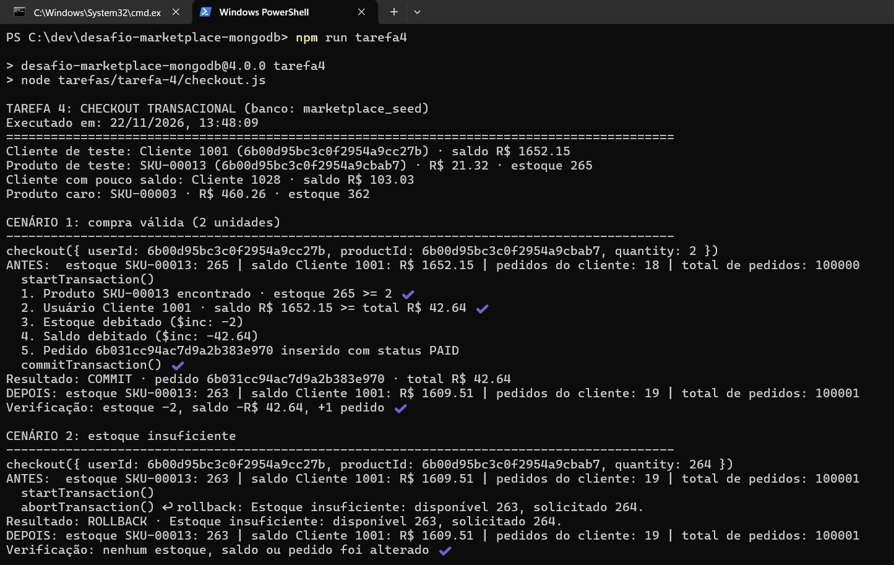
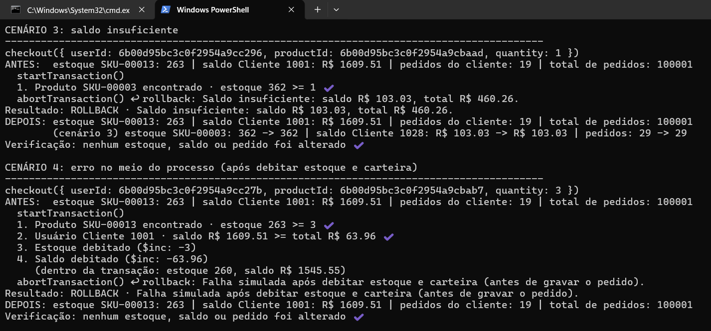
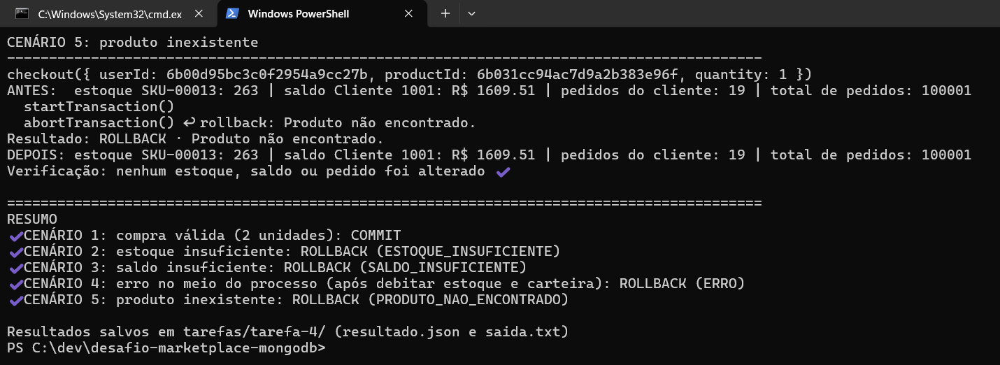

# Tarefa 4: Consistência e Transações ACID

**Desafio Técnico Back-End: Engenharia de Dados com MongoDB**
Luka Gomes · Desenvolvimento de Software Multiplataforma · FATEC Jacareí · 22/11/2026

---

## 1. Objetivo

Implementar uma função transacional de **checkout** que recebe `userId`, `productId` e `quantity` e executa, de forma **atômica**:

1. Verificar se o produto existe e se possui `stock >= quantity`;
2. Verificar se o usuário possui `walletBalance >= price * quantity`;
3. Debitar o estoque do produto (`$inc`);
4. Debitar o saldo da carteira do usuário (`$inc`);
5. Inserir o novo documento na coleção `orders` com status `"PAID"`.

Se qualquer validação falhar ou ocorrer um erro no meio do processo, toda a operação deve sofrer **rollback** (`abortTransaction`), sem deixar saldo ou estoque inconsistente.

| Item | Valor |
|---|---|
| Banco | `marketplace_seed` (Parte 4): coleções `products`, `users` e `orders` |
| Servidor | MongoDB 9.0.4 configurado como **replica set `rs0`** |
| Código | `tarefas/tarefa-4/checkout.js` (função `checkout` exportada + demonstração) |
| Execução | `npm run tarefa4`, em **22/11/2026, 13:48** |
| Evidências brutas | `saida.txt` e `resultado.json` (mesma pasta) |

---

## 2. Por que uma transação é necessária

O checkout altera **três documentos em três coleções diferentes**: o produto (estoque), o usuário (saldo) e um pedido novo. No MongoDB, uma operação isolada já é atômica **dentro de um único documento**, mas não entre documentos diferentes. Sem transação, uma falha no meio do caminho deixaria o banco inconsistente. Por exemplo:

- o estoque foi debitado, mas o servidor caiu antes de debitar a carteira → **produto "sumiu" sem pagamento**;
- estoque e carteira foram debitados, mas a gravação do pedido falhou → **cliente pagou e não tem pedido**.

A transação multi-documento garante as propriedades **ACID**:

| Propriedade | Como aparece no checkout |
|---|---|
| **A**tomicidade | Os 3 passos de escrita são confirmados juntos no `commitTransaction`, ou nenhum é (`abortTransaction`) |
| **C**onsistência | As regras (estoque e saldo suficientes) são verificadas dentro da transação, e o banco nunca fica num estado intermediário |
| **I**solamento | Com `readConcern: "snapshot"`, a transação enxerga uma "foto" consistente dos dados, e as alterações dela ficam invisíveis para outras operações até o commit |
| **D**urabilidade | `writeConcern: { w: "majority" }`: o commit só é confirmado depois de gravado de forma durável no replica set |

> **Pré-requisito:** transações só funcionam em **replica set** (ou cluster *sharded*), porque dependem do *oplog*. Por isso o MongoDB local foi configurado como replica set de um nó (`replSetName: rs0` no `mongod.cfg` + `rs.initiate()`), e a URI de conexão usa `?replicaSet=rs0`, como já indicava o script de seed do professor.

---

## 3. Implementação

### 3.1 Função `checkout`

Trecho principal de `checkout.js` (o arquivo completo também inclui os logs de cada passo e a demonstração):

```js
async function checkout(client, { userId, productId, quantity }) {
  // Validação de entrada, antes de abrir a transação
  if (!ObjectId.isValid(userId) || !ObjectId.isValid(productId))
    throw new CheckoutError('ID_INVALIDO', 'userId e productId devem ser ObjectIds válidos.');
  if (!Number.isInteger(quantity) || quantity <= 0)
    throw new CheckoutError('QUANTIDADE_INVALIDA', 'quantity deve ser um inteiro maior que zero.');

  const session = client.startSession();
  try {
    session.startTransaction({
      readConcern: { level: 'snapshot' },
      writeConcern: { w: 'majority' },
      readPreference: 'primary',
    });

    try {
      // 1) Produto existe e tem estoque suficiente?
      const produto = await products.findOne({ _id: pid }, { session });
      if (!produto) throw new CheckoutError('PRODUTO_NAO_ENCONTRADO', 'Produto não encontrado.');
      if (produto.stock < quantity) throw new CheckoutError('ESTOQUE_INSUFICIENTE', '...');

      // 2) Usuário existe e tem saldo suficiente?
      const total = arredondar(produto.price * quantity);
      const usuario = await users.findOne({ _id: uid }, { session });
      if (!usuario) throw new CheckoutError('USUARIO_NAO_ENCONTRADO', 'Usuário não encontrado.');
      if (usuario.walletBalance < total) throw new CheckoutError('SALDO_INSUFICIENTE', '...');

      // 3) Debita o estoque ($inc). O filtro repete a condição como proteção extra
      const r1 = await products.updateOne(
        { _id: pid, stock: { $gte: quantity } }, { $inc: { stock: -quantity } }, { session });
      if (r1.modifiedCount !== 1) throw new CheckoutError('CONFLITO_ESTOQUE', '...');

      // 4) Debita o saldo da carteira ($inc)
      const r2 = await users.updateOne(
        { _id: uid, walletBalance: { $gte: total } }, { $inc: { walletBalance: -total } }, { session });
      if (r2.modifiedCount !== 1) throw new CheckoutError('CONFLITO_SALDO', '...');

      // 5) Insere o pedido com status PAID (mesmo formato dos pedidos do seed)
      const pedido = {
        userId: uid, shippingCity: usuario.city, status: 'PAID',
        items: [{ productId: pid, sku: produto.sku, category: produto.category,
                  unitPrice: produto.price, quantity }],
        totalAmount: total, createdAt: new Date(),
      };
      const { insertedId } = await orders.insertOne(pedido, { session });

      await session.commitTransaction();          // tudo confirmado de uma vez
      return { _id: insertedId, ...pedido };
    } catch (err) {
      if (session.inTransaction()) await session.abortTransaction();   // ROLLBACK
      throw err;
    }
  } finally {
    await session.endSession();
  }
}
```

### 3.2 Decisões de implementação

- **Todas as operações recebem `{ session }`.** É isso que as coloca dentro da transação. Uma operação sem a sessão seria executada fora dela e não seria desfeita no rollback.
- **`startTransaction` / `commitTransaction` / `abortTransaction` explícitos.** O enunciado pede o rollback com `abortTransaction`, então o fluxo foi escrito de forma explícita, deixando visível onde a transação começa, onde é confirmada e onde é desfeita. Qualquer exceção, seja de regra de negócio ou erro inesperado, cai no `catch`, que chama `abortTransaction()`.
- **`$inc` com condição no filtro.** Além da verificação dos passos 1 e 2, os `updateOne` repetem a condição (`stock: { $gte: quantity }` e `walletBalance: { $gte: total }`). Se, por qualquer motivo, o valor tiver mudado entre a leitura e a escrita, `modifiedCount` vem 0 e a transação é abortada. É uma camada extra de proteção contra estoque ou saldo negativos.
- **Erros transitórios.** Quando duas transações tentam alterar o mesmo documento ao mesmo tempo, o MongoDB aborta uma delas com o rótulo `TransientTransactionError`. O código completo repete automaticamente a transação inteira (até 3 tentativas), como recomenda a documentação. Se o resultado do commit for incerto (`UnknownTransactionCommitResult`), o commit é repetido.
- **Validação de entrada fora da transação.** IDs inválidos e quantidade não inteira ou ≤ 0 são rejeitados antes de abrir a sessão, sem custo para o banco. Uma quantidade negativa, por exemplo, faria o `$inc` **aumentar** o estoque.
- **Produto inativo.** Validação adicional: produtos com `active: false` (cerca de 10% do seed) não podem ser vendidos.
- **Formato do pedido.** O pedido é gravado com a mesma estrutura dos pedidos do seed (`items[]` com `sku`, `category` e `unitPrice`), então ele entra normalmente nos relatórios da Tarefa 2 e na consulta otimizada da Tarefa 3.

---

## 4. Demonstração: cenários testados

Para comprovar o comportamento, a demonstração executa 5 cenários e mostra o estoque, o saldo e a quantidade de pedidos **antes e depois** de cada um.

**Dados de teste** (escolhidos de forma determinística no banco):

| Papel | Documento | Valores iniciais |
|---|---|---|
| Cliente | Cliente 1001 (`6b00d95bc3c0f2954a9cc27b`) | saldo **R$ 1.652,15**, 18 pedidos |
| Produto | SKU-00013 (`6b00d95bc3c0f2954a9cbab7`) | **R$ 21,32**, estoque **265** |
| Cliente com pouco saldo | Cliente 1028 | saldo **R$ 103,03** |
| Produto caro | SKU-00003 | **R$ 460,26**, estoque 362 |

### 4.1 Resultados

| # | Cenário | Resultado | Estoque | Saldo | Pedidos |
|---|---|---|---|---|---|
| 1 | Compra válida (2 un. de SKU-00013) | ✅ **COMMIT** | 265 → **263** | R$ 1.652,15 → **R$ 1.609,51** (−R$ 42,64) | 18 → **19** (total 100.000 → 100.001) |
| 2 | Estoque insuficiente (264 un., disponível 263) | ↩ **ROLLBACK** | 263 → 263 | sem alteração | sem alteração |
| 3 | Saldo insuficiente (Cliente 1028: R$ 103,03 para R$ 460,26) | ↩ **ROLLBACK** | 362 → 362 | R$ 103,03 → R$ 103,03 | 29 → 29 |
| 4 | **Erro no meio do processo** (após debitar estoque e carteira) | ↩ **ROLLBACK** | 263 → **263** | R$ 1.609,51 → **R$ 1.609,51** | 19 → 19 |
| 5 | Produto inexistente | ↩ **ROLLBACK** | sem alteração | sem alteração | sem alteração |

### 4.2 O cenário que comprova o rollback (cenário 4)

Nos cenários 2, 3 e 5, a falha acontece **antes** de qualquer escrita. O cenário 4 é o mais importante, porque simula exatamente o caso descrito no enunciado: um **erro no meio do processo, depois que o estoque e a carteira já foram debitados**, e antes de gravar o pedido.

Trecho da saída (`saida.txt`):

```text
CENÁRIO 4: erro no meio do processo (após debitar estoque e carteira)
checkout({ userId: 6b00d95bc3c0f2954a9cc27b, productId: 6b00d95bc3c0f2954a9cbab7, quantity: 3 })
ANTES:  estoque SKU-00013: 263 | saldo Cliente 1001: R$ 1609.51 | pedidos do cliente: 19 | total de pedidos: 100001
  startTransaction()
  1. Produto SKU-00013 encontrado · estoque 263 >= 3 ✔
  2. Usuário Cliente 1001 · saldo R$ 1609.51 >= total R$ 63.96 ✔
  3. Estoque debitado ($inc: -3)
  4. Saldo debitado ($inc: -63.96)
     (dentro da transação: estoque 260, saldo R$ 1545.55)
  abortTransaction() ↩ rollback: Falha simulada após debitar estoque e carteira (antes de gravar o pedido).
Resultado: ROLLBACK
DEPOIS: estoque SKU-00013: 263 | saldo Cliente 1001: R$ 1609.51 | pedidos do cliente: 19 | total de pedidos: 100001
Verificação: nenhum estoque, saldo ou pedido foi alterado ✔
```

**Dentro da transação**, as duas escritas aconteceram: o estoque chegou a **260** e o saldo a **R$ 1.545,55**. Depois do `abortTransaction()`, o banco voltou exatamente ao estado anterior: estoque **263**, saldo **R$ 1.609,51** e nenhum pedido novo. Sem a transação, esse erro teria deixado 3 unidades a menos no estoque e R$ 63,96 a menos na carteira, sem pedido correspondente.

### 4.3 Resumo da execução

```text
RESUMO
✔ CENÁRIO 1: compra válida (2 unidades): COMMIT
✔ CENÁRIO 2: estoque insuficiente: ROLLBACK (ESTOQUE_INSUFICIENTE)
✔ CENÁRIO 3: saldo insuficiente: ROLLBACK (SALDO_INSUFICIENTE)
✔ CENÁRIO 4: erro no meio do processo (após debitar estoque e carteira): ROLLBACK (ERRO)
✔ CENÁRIO 5: produto inexistente: ROLLBACK (PRODUTO_NAO_ENCONTRADO)
```

---

## 5. Observações

- **Impacto no banco:** apenas o cenário 1 alterou dados de forma permanente: 1 pedido novo (o banco passou de 100.000 para 100.001 pedidos), 2 unidades a menos no SKU-00013 e R$ 42,64 a menos no saldo do Cliente 1001. Os cenários com rollback não deixaram nenhum rastro.
- **Valores monetários:** o seed armazena preços e saldos como números decimais (`double`). O total é arredondado para 2 casas antes do débito. Num sistema real, o ideal seria guardar valores em **centavos (inteiros)** ou no tipo **`Decimal128`**, para eliminar qualquer imprecisão de ponto flutuante em operações repetidas.
- **Custo das transações:** transações têm um custo maior que operações simples (bloqueios e coordenação no commit) e devem ser curtas. Por isso a função faz apenas o essencial dentro da transação, e as validações de entrada ficam do lado de fora.

---

## 6. Conclusão

A função `checkout` executa os cinco passos pedidos dentro de uma **transação multi-documento**, envolvendo três coleções. Os testes comprovaram os dois lados do "tudo ou nada": no caso válido, estoque, saldo e pedido foram gravados juntos (**commit**); em todas as falhas, inclusive um erro forçado depois de estoque e carteira já terem sido debitados, o **`abortTransaction()`** desfez tudo, e nenhum saldo ou estoque ficou inconsistente.

---

<div style="page-break-before: always"></div>

## 7. Evidências






